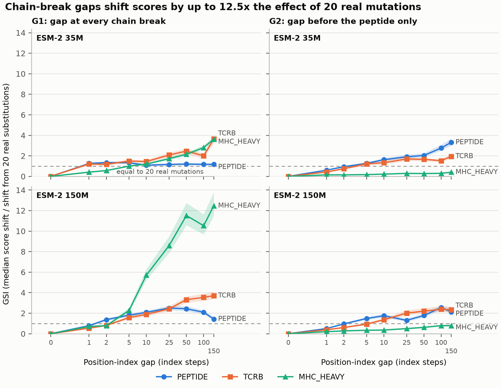

# Chain-layout sensitivity in concatenation-based protein interface models

I was curious about whether protein language models are sensitive to something that carries no biological information: where the chain breaks fall. Sequence-level models of multi-chain complexes (TCR-pMHC, antibody-antigen, peptide-MHC) typically concatenate the chains into one string and score it with a protein language model. The relative position between two chains then depends on the length of any chain placed between them, so a CDR3-beta that is three residues longer shifts every downstream peptide-to-MHC offset by three. Structure predictors address this by inserting a large residue-index offset at chain breaks. This repository tests whether ESM-2 is sensitive to the equivalent change, and whether a chain-aware positional module reduces that sensitivity.

The full write-up is in [`docs/REPORT.md`](docs/REPORT.md).

## Summary of results

**Phase 1: sensitivity audit.** ESM-2 uses rotary position embeddings and accepts `position_ids`, so the position indices can be changed while every token stays identical (verified with `torch.equal` on the inputs). Adding a constant gap to the indices at each chain break shifts the pseudo-log-likelihood of the MHC heavy chain. The shift is expressed as the Geometry Sensitivity Index (GSI), the median absolute score change from the gap divided by the median absolute score change from 20 amino-acid substitutions in a context chain.

- At gaps of 25 to 100, GSI for the MHC heavy chain is 4.8 to 10.5 on the main sample at ESM-2 150M and 650M (cluster-bootstrap 95% lower bounds 1.96 to 9.78). On an allele-balanced sample of 51 HLA alleles it is 3.3 to 11.7.
- The effect requires a gap of about 25 index steps. At gaps of 1 to 5, GSI is 0.5 to 2.3.
- GSI is lower at 650M than at 150M and remains above 1.
- Peptide and CDR3-beta scoring fail a pre-set admissibility check at every model size (median span score within 0.25 nats of a uniform prior), so no claim is made for them. Only the MHC heavy chain at 150M and 650M is evaluable.
- Zero-shot concatenated ESM-2 does not discriminate TCR-pMHC binders from mismatched decoys (AUROC 0.48 to 0.57).



**Phase 2: chain-aware module.** `ChainAwarePositions` combines per-chain position reset, a learned chain-identity embedding, and a chain-break offset, each independently switchable. It was compared with a baseline (A0) under LoRA fine-tuning at 35M and 650M parameters, with matched trainable parameters, batches, and schedules.

- Complexes matched on allele and peptide that differ only in CDR3-beta length show no length-attributable effect on the MHC score. The excess slope over a shuffled-length null is 0.0003 nats per residue (95% interval -0.0013 to 0.0018). Natural CDR3-beta length varies by 3 to 4 residues, well below the offset needed to produce the effect.
- Trained as a binding classifier (three seeds per arm), no arm exceeds chance AUROC on either held-out shard, so the pre-registered improvement hypothesis (H2) is not supported.
- Paired by seed, the module raised held-out-epitope AUROC in all 12 arm-seed comparisons (mean paired difference +0.07 to +0.10), and the full module lowered held-out-allele AUROC in all 6 seed-size comparisons (mean difference -0.06 at 35M, -0.13 at 650M). The baseline is below chance on the epitope shard, the analysis was chosen after the unpaired result was seen, and the corrected sign tests are not significant. This is reported as a direction for further work.
- The module reduces the MHC score margin over the uniform prior in proportion to how much of it is enabled: +0.751 nats for the baseline, +0.054 for the full module, and -0.149 with chain-order augmentation. Held-out masked-LM loss does not reveal this cost.

On this evidence, adopting a chain-aware positional module is not recommended for CDR3-based TCR-pMHC scoring. The sensitivity is real at large offsets, and natural chain-length variation in this dataset does not reach them. Full-length TCR variable domains and backbones fine-tuned for binding are the settings in which the conclusion could change.

## Data and models

- VDJdb release 2026-06-03 (human, MHC class I, paired CDR3-alpha and CDR3-beta; 83,886 of 192,753 rows retained), IPD-IMGT/HLA 3.65.0, and beta-2 microglobulin (UniProt P61769). After deduplication there are 76,524 complexes of 305 to 332 residues. Sources and filters are in [`data/SOURCES.md`](data/SOURCES.md).
- ESM-2 35M, 150M, and 650M in float32. Alleles and epitopes are held out by membership, and a held-out epitope removes every TCR seen against it ([`configs/splits.yaml`](configs/splits.yaml)).
- Decoys are mismatched receptor-antigen pairs, not validated non-binders.
- All runs used one Apple M4 Max (MPS and CPU). See [`docs/COMPUTE_LOG.md`](docs/COMPUTE_LOG.md).

## Limitations

- Two of nine model-target conditions pass the admissibility check, both on the MHC heavy chain. The peptide and CDR3 spans, which determine binding specificity, are unevaluated.
- The admissibility rule (uniform-prior reference, 0.25 nat threshold) may be miscalibrated for hypervariable spans. It was left unchanged after the GSI results were seen. A dataset-unigram reference fixed in advance is the first item of future work.
- The backbone is not trained for binding. Nothing here applies to a fine-tuned interface model.
- TCR chains are CDR3 loops only, so chain-length variation is much smaller than in full receptors.
- The main sample is dominated by HLA-A\*02:01 (69% of examples, effective sample size 1.9). The allele-balanced runs address this, but bootstrap intervals over 9 to 14 clusters are optimistic.
- The binding classifiers use three seeds per arm and the masked-LM arms use one.
- The GSI and admissibility metrics were defined after a 60-example pilot, and six earlier claims were withdrawn during the work. [`docs/REPORT.md`](docs/REPORT.md) lists them with the reasons, and [`docs/DECISIONS.md`](docs/DECISIONS.md) records each change when it was made.
- Class I only, one backbone family, no wet-lab validation. The work makes no claim about TCR design or binding prediction accuracy.

## Reproducing

```bash
make setup     # create the virtual environment and install pinned dependencies
make data      # download VDJdb and IPD-IMGT/HLA and assemble complexes (idempotent)
make audit     # Phase 1: score, perturb, rescore, compute GSI with cluster-bootstrap intervals
make report    # regenerate figures and tables from the committed results
make test      # test suite, CPU only
```

Requires Python 3.12. The 650M runs used about 29 minutes per training arm on the hardware above.

## Repository layout

```
src/cla/
  data/     source download, assembly from allele name to chain sequence, splits
  layout/   chain specification, concatenation, geometry and perturbation operators
  model/    ESM-2 loading, span pseudo-log-likelihood, chain-aware positional module
  train/    LoRA arms, binding classifier, training gates
  eval/     metrics, audit driver, cluster bootstrap, figures
  utils/    seeding, run manifests, logging
configs/    base, audit, and training configurations; splits.yaml defines held-out data
docs/       REPORT.md, DECISIONS.md, AUDIT.md, COMPUTE_LOG.md
results/    committed metrics, tables, and figures
tests/
```

[`PROJECT_PLAN.md`](PROJECT_PLAN.md) is the original plan written before the experiments.

## License

MIT. See [`LICENSE`](LICENSE).
